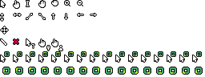

# Familiar Pixel Cursors

Pixel Art Cursor Pack expanding on <https://astropulse.itch.io/familiar-pixel-cursors> by [Astropulse](https://astropulse.co)

I added a few cursors (grab, grabbing, zoom in/out, text) and made it linux compatible (xcursors)



## Building

Run `make` to build (requires xcursorgen and ffmpeg)

You can customize the output sizes by setting the `SIZES` environment variable. It accepts a space-separated list of numbers, each of which must be a multiple of 16.

For example:

```
SIZES="16 32 48 64" make
```

## Credits

The original cursor pack was created by Astropulse

If you enjoy the original pack, consider supporting Astropulse!
